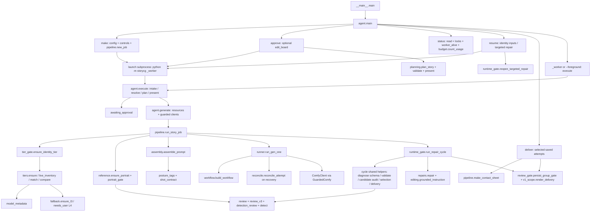

# 入口与调用关系

## 正式入口和 worker

`make/approve/resume` 的 foreground 路径直接调用 execute；后台 `launch` 通过 subprocess 重回 `__main__` 的 `_worker`，不是静态Python调用，已在 static.json 标为manual边。status/deliver 不主动启动生成或模型审核；此处是源码审计描述，AUD-01没有运行这些命令。

## 旧 CLI 和开发入口

`__main__.main` 还可执行 new/run/gen-one/resolve/plan/review/detect；旧状态无agent.json时 status/resume 走 runner 与 pipeline。只从这个旧入口新增可达的定义包括 __main__._summary、detect.cli/draw_overlay、pipeline.resolve_and_validate_job、runner.resume_job（__main__.main本身是所有入口的引导层）。正式门面的最上层__main__分派也实际会执行；为隔离旧分支，AST“facade”根从agent.main开始。

3个 calibration 模块仅由tools/校准入口调用，互相复用 mapped_status/summarize，不是 worker 热路径。它们在callgraph.dot中无活跃调用边，但有真实离线验证证据。

## 保守 AST 规则

AST不导入生产包；解析直接名称、别名、局部import、`from cycle import *`和runtime_gate同名覆盖。函数调用按**函数定义所在模块的全局环境**解析，所以cycle.repair_schedule仍调用cycle.repair_findings，而runtime_gate调用它自己的repair_findings。类构造、self方法、继承、被传入函数的引用、client/vlm类型提示、代理协议和worker边分别标记。receiver_hint/callback_reference只是可能关系；动态外部方法无法静态证明。

所有函数、类和嵌套定义的可达/不可达、所在行、调用者、外部引用在functions.tsv；全部边在call_edges.tsv。不把“import模块”当作调用它全部函数，也不把没有日志当作永远不可达。

## 当前不可达定义

| 定义 | 行 | 分类 | 引用 |
|---|---:|---|---|
| `storycg.cycle.apply_round` | 601–648 | 只由测试链可达 | 间接调用者：storycg.cycle.run_repair_cycle |
| `storycg.cycle.detection_improved` | 79–92 | 只由测试链可达 | `tests/test_detection_review.py`、`tests/test_p9_06.py` |
| `storycg.cycle.diagnose` | 256–286 | 只由测试链可达 | 间接调用者：storycg.cycle.run_repair_cycle |
| `storycg.cycle.run_repair_cycle` | 482–598 | 只由测试链可达 | `tests/test_cycle.py` |
| `storycg.cycle.run_repair_cycle.persist` | 494–494 | 只由测试链可达 | 间接调用者：storycg.cycle.run_repair_cycle |
| `storycg.cycle.run_repair_cycle.quota` | 495–501 | 只由测试链可达 | 间接调用者：storycg.cycle.run_repair_cycle |
| `storycg.detect.crop_face` | 63–67 | 只由测试链可达 | `tests/test_detect.py` |
| `storycg.repairs.composite_region` | 142–145 | 只由测试链可达 | `tests/test_repairs.py` |
| `storycg.repairs.rewrite_composition` | 396–417 | 只由测试链可达 | `tests/test_p9_07.py`、`tests/test_repairs.py` |
| `storycg.tiers.build_l2_workflow` | 134–142 | 只由测试链可达 | `tests/test_p6_01.py`、`tests/test_p6_02_rework1.py`、`tests/test_p6_reference_policy.py` |
| `storycg.tiers.determine_l1` | 84–102 | 只由测试链可达 | `tests/test_p6_01.py`、`tests/test_p6_01b.py` |
| `storycg.tiers.prepare_l2` | 275–297 | 只由测试链可达 | `tests/test_p6_01.py` |
| `storycg.calibration.mapped_status` | 7–27 | 工具/校准链可达 | `tools/p4_calibrate.py` |
| `storycg.calibration.summarize` | 30–63 | 工具/校准链可达 | `tests/test_p4_review.py`、`tools/p4_calibrate.py`、`tools/p4_verify_calibration.py` |
| `storycg.calibration_v2.aggregate` | 25–29 | 工具/校准链可达 | 间接调用者：storycg.calibration_v2.map_visual |
| `storycg.calibration_v2.item_truth` | 32–38 | 工具/校准链可达 | 间接调用者：storycg.calibration_v2.summarize |
| `storycg.calibration_v2.map_visual` | 10–22 | 工具/校准链可达 | `tools/p10_02_calibrate.py`、`tools/p10_02_verify_partial.py`、`tools/p9_04_calibrate.py`、`tools/p9_04_verify.py` |
| `storycg.calibration_v2.summarize` | 41–77 | 工具/校准链可达 | `tests/test_p9_04.py`、`tools/p10_02_calibrate.py`、`tools/p10_02_verify_partial.py`、`tools/p9_04_calibrate.py`、`tools/p9_04_verify.py` |
| `storycg.calibration_v3.accessory_mapping` | 30–36 | 工具/校准链可达 | `tools/p10_02_calibrate.py`、`tools/p10_02_verify_partial.py` |
| `storycg.calibration_v3.stats` | 8–27 | 工具/校准链可达 | `tools/p10_02_verify_partial.py`、`tools/p10_03_development.py`、`tools/test_p10_02.py` |
| `storycg.calibration_v3.summarize` | 39–47 | 工具/校准链可达 | `tools/p10_02_calibrate.py` |
| `storycg.repairs.fork_repair_job` | 163–187 | 工具/校准链可达 | `tests/test_repairs.py`、`tools/p5_01_run.py`、`tools/p5_01b_run.py`、`tools/p9_02_live.py`、`tools/p9_02_r1_live.py` |
| `storycg.repairs.region_queries` | 51–63 | 工具/校准链可达 | `tests/test_repairs_regions.py`、`tools/p5_01b_localize.py`、`tools/p5_01b_run.py` |
| `storycg.review.crop_face` | 394–407 | 工具/校准链可达 | `tests/test_review.py`、`tools/p3_review.py`、`tools/p4_calibrate.py`、`tools/p5_01_review.py`、`tools/p5_01b_review.py` |
| `storycg.runtime_gate.detection_improved` | 360–365 | 无入口或外部引用链 | 间接调用者： |

完整模块级关系见callgraph.dot；灰色是没有CLI函数调用边的模块，__init__只有被导入的包初始化，不是死模块。
